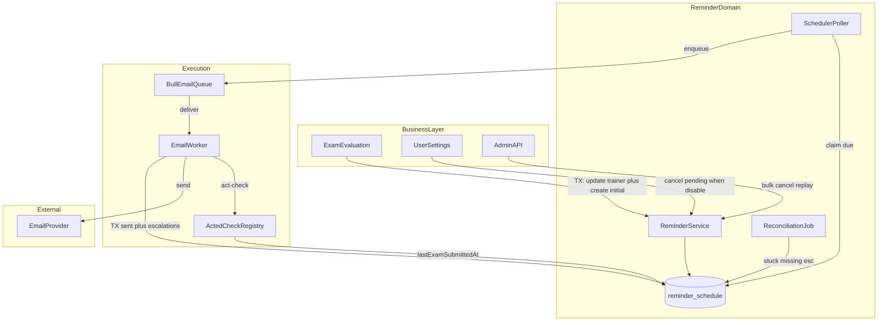
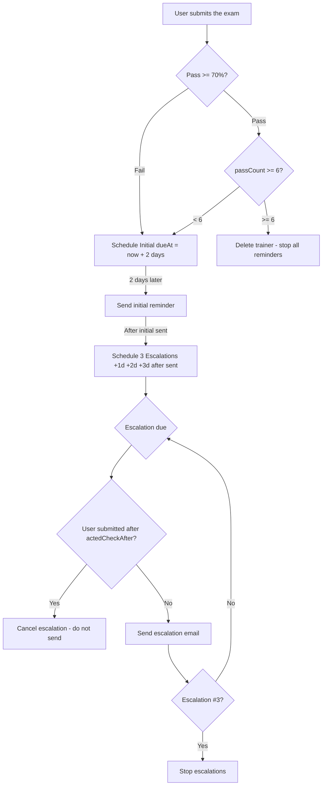
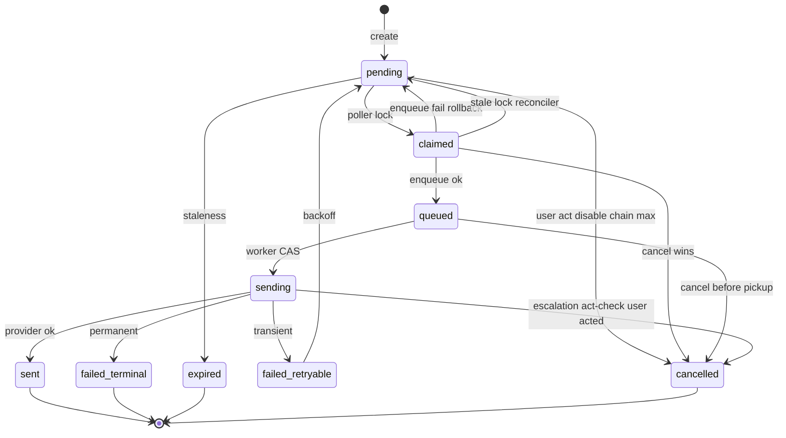
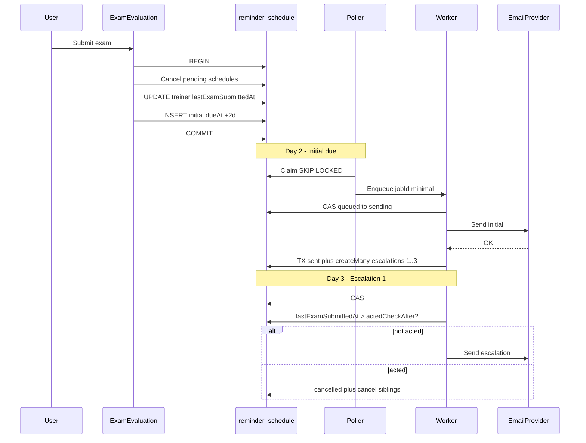
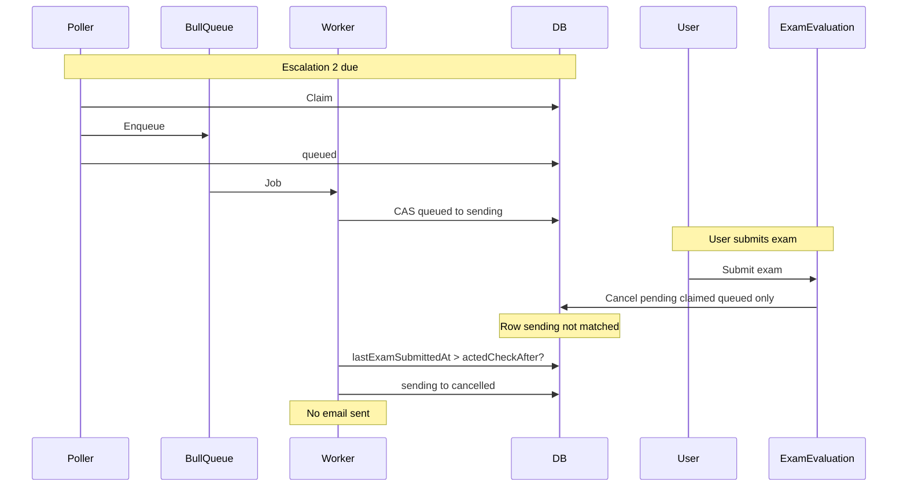

# Reminder mail & Escalation (design v3)

> **Update (#42):** the rules for counting a Pass, the per-trainer spacing (X) and max passes (T), the fail-streak prompt, the send guard and the bell lifetimes (90 days for Reminder bells, both kinds) changed. See `docs/features/pass-counting.md`. The email now says "Next reminder: in N days after your attempt." The sections below describe the v3 design and are not all updated.

This document describes the **DB-first** flow: `reminder_schedule` is the source of truth, **SchedulerPoller** claims due rows, **Bull** only carries execution (`attempts: 1`, retries are handled by the DB), and **EmailWorker** sends the email and (for initial reminders) creates escalations **in the same transaction** as `sent`.

**Principles of v3**

| #   | Principle                                                                                     |
| --- | --------------------------------------------------------------------------------------------- |
| 1   | **The DB is the source of truth** — if the queue is lost, the poller re-enqueues from the DB. |
| 2   | **Idempotent sending** — target duplicate rate below 0.01%.                                   |
| 3   | **Defense in depth** — bulk cancel in the exam transaction + pre-send act-check + reconciler. |
| 4   | **Fail-safe** — a crash at any step has a recovery path.                                      |
| 5   | **Explicit** — the act-check uses **`lastExamSubmittedAt`**, **not** `updatedAt`.             |

**In scope for v1:** initial (+2 days), escalation (max 3), state machine, DB retry, pre-send act-check, chain limit (~30 cycles per trainer), reconciliation, cancel when the user acts, disables reminders or deletes the trainer.

**Out of scope for v1:** RRULE/cron; SMS/push (the schema may allow them later); timezone-aware scheduling; bounce webhooks.

Detailed implementation plan (todos, dependencies, rollout): see the repo plan `.cursor/plans/reminder-mail-workflow-plan_dfde5e9d.plan.md`.

---

## Table of contents

1. [System architecture](#1-system-architecture)
2. [Requirements analysis & timeline](#2-requirements-analysis--timeline)
3. [Schema](#3-schema)
4. [State machine](#4-state-machine)
5. [Act-check & `lastExamSubmittedAt`](#5-act-check--lastexamsubmittedat)
6. [Escalation lifecycle](#6-escalation-lifecycle)
7. [Implementation](#7-implementation)
8. [Poller & collapse overdue](#8-poller--collapse-overdue)
9. [Reconciliation](#9-reconciliation)
10. [Rollout (from direct queue → DB-first)](#10-rollout-from-direct-queue--db-first)
11. [Edge cases & race](#11-edge-cases--race)
12. [Config, SLO & metrics](#12-config-slo--metrics)
13. [Test checklist](#13-test-checklist)
14. [Example DB states](#14-example-db-states)
15. [Diagram: race bulk cancel vs `sending`](#15-diagram-race-bulk-cancel-vs-sending)

---

## 1. System architecture



**Flow of one cycle (summary)**

- **Day 0:** Transaction — update `vocab_trainer` (result, **`lastExamSubmittedAt`**), insert the `reminder_schedule` initial with `dueAt = +2 days`.
- **Day 2:** Poller `SKIP LOCKED` → `claimed` → `Bull.add` → `queued`. Worker `queued` → `sending` (CAS); the initial reminder does **not** run the act-check. Email sent OK → **one transaction**: `sent` + `createMany` of 3 escalations (`dueAt = sentAt + 1/2/3 days`, `actedCheckAfter = sentAt`).
- **Day 3+:** Escalation: CAS → act-check (`lastExamSubmittedAt > actedCheckAfter`) → cancel siblings or send → `sent`.

---

## 2. Requirements analysis & timeline

- **Day 0:** User submits the exam
- **Day 2:** Send the initial reminder
- **Day 3–5:** Up to 3 escalations (one per day after the initial was sent). Stop after escalation #3, or when the user has passed 6 times or reached the chain limit



---

## 3. Schema

### 3.1 `vocab_trainer`

```sql
ALTER TABLE vocab_trainer
  ADD COLUMN last_exam_submitted_at TIMESTAMPTZ NULL;
```

Only update this when the user **actually submits** an exam. Do not use `updatedAt` for the act-check, because every other UPDATE also bumps `updatedAt`.

### 3.2 `reminder_schedule` (main field groups)

- **Identity:** `id`, `dedupe_key` (unique partial index when not cancelled/expired)
- **Delivery:** `channel` (v1: `CHECK (channel IN ('email'))`), `recipient`
- **Content:** `template`, `template_version`, `payload`, `subject`
- **Scheduling:** `due_at`, `priority`, `next_attempt_at` (DB retry)
- **State:** `status`, `attempt`, `max_attempts`
- **Lock poller:** `locked_by`, `locked_at`
- **Escalation:** `reminder_type` (`initial` | `escalation`), `escalation_level`, `escalation_max`, `initial_reminder_id`, `acted_check_after`
- **Chain:** `chain_count`, `chain_max`
- **Cancel / completion:** `cancelled_at`, `cancel_reason`, `sent_at`, `completed_at`
- **Business:** `user_id`, `entity_type`, `entity_id`, `metadata`

**Index (Postgres):**

- **Do not** use `now()` in the predicate of a **partial index** (it is not immutable). The condition `due_at <= now()` runs in the query.
- Suggested indexes: poller `(status, due_at)`, pending entity, escalation, user, stuck `claimed`.

### 3.3 Prisma (suggestion)

```prisma
model ReminderSchedule {
  // ... identity, delivery, content, scheduling, state, lock, errors,
  // escalation, chain, cancel, sentAt, entity, userId, metadata ...

  reminderType      String    @default("initial") @map("reminder_type")
  escalationLevel   Int       @default(0) @map("escalation_level")
  escalationMax     Int       @default(3) @map("escalation_max")
  initialReminderId String?   @map("initial_reminder_id") @db.Uuid
  initialReminder   ReminderSchedule?  @relation("Escalation", fields: [initialReminderId], references: [id])
  escalations       ReminderSchedule[] @relation("Escalation")
  actedCheckAfter   DateTime? @map("acted_check_after") @db.Timestamptz
}
```

---

## 4. State machine

States: `pending` → `claimed` → `queued` → `sending` → `sent` | `failed_retryable` | `failed_terminal` | `cancelled` | `expired`.

- **`sending` → `cancelled`:** only for escalations, when the act-check shows the user **submitted after** `actedCheckAfter`, **before** the provider is called.
- **`failed_retryable` → `pending`:** after backoff (retry is handled by the DB, not by Bull's retries).



---

## 5. Act-check & `lastExamSubmittedAt`

### 5.1 Two layers of protection

1. **Exam submit transaction:** `updateMany` cancels `pending | claimed | queued` rows by `entity_type` + `entity_id`. It does **not** cancel `sending` (a worker is already processing it).
2. **Worker (escalation):** compare `trainer.lastExamSubmittedAt > actedCheckAfter` (the mark is the `sentAt` of the initial). If true → cancel the current escalation and the pending siblings, and **do not send the email**.

### 5.2 Why not `updatedAt`

`updatedAt` is bumped by migrations, admin edits and batch jobs. That causes **false positives** (we think the user acted when they did not).

### 5.3 Strategy pattern (extending entities)

- `ActedCheckRegistry` + `VocabTrainerActedCheck`: reads `lastExamSubmittedAt`.
- Trainer **deleted** → treat it as already acted (do not send a pointless escalation).
- **TOCTOU:** a small window still exists between the act-check and `provider.send`. We accept that an extra email rarely happens; there is no user lock.

---

## 6. Escalation lifecycle

### 6.1 Strategy: pre-schedule + pre-send check

After the **initial** moves to `sent`, **one transaction** creates all 3 escalation rows (`createMany`; use `skipDuplicates` or handle the unique key so the reconciler is idempotent). Each row has `dueAt` at +1/+2/+3 days from `sentAt`, all with `actedCheckAfter = sentAt`.

### 6.2 Sequence (happy path) — updated for v3



---

## 7. Implementation

### 7.1 Exam flow (multiple-choice & fill-in-blank)

- **Same business flow:** one **shared service** (for example `VocabTrainerReminderAfterExam`) takes a `Prisma.TransactionClient`, updates the trainer and `lastExamSubmittedAt`, cancels pending schedules, creates a new initial, or deletes the trainer if it passed 6 times.
- `vocab-trainer.service.ts` (multiple-choice) and `fill-in-blank-evaluation.processor.ts` **call this service**. They do not copy-paste two versions of the logic.

### 7.2 Worker

- **Minimal queue payload:** `{ scheduleId }` — always re-read the DB (less PII in Redis, avoids stale data).
- Order: pre-flight `queued` → CAS `sending` → (escalation) act-check → render template (render error → terminal) → send → **transaction** `sent` + `createEscalationsInTx` if initial.
- Bull: **`attempts: 1`** — retries are handled by the **DB** (`next_attempt_at`, `failed_retryable`).

### 7.3 Dedupe key

Build keys through a util (for example `buildReminderDedupeKey.initial(trainerId, chainCount)`, `.escalation(initialKey, level)`). Avoid hard-coded strings scattered around the code.

### 7.4 `createMany` for escalations + unique `dedupe_key`

Use `skipDuplicates: true` (Prisma) or `ON CONFLICT DO NOTHING` when the reconciler re-creates rows after a crash in the middle.

---

## 8. Poller & collapse overdue

- Interval ~5s, batch ~50, `enqueueWithRollback`: if Redis fails → roll back `claimed` → `pending`.
- **Graceful shutdown:** `OnModuleDestroy` — wait for the current poll loop to finish, to reduce stuck `claimed` rows.
- **Collapse overdue:** after a long downtime, many pending escalations can be overdue at the same time. **Expire** the old ones in the same chain and **keep** the one with the highest `escalation_level` (only when `COUNT > 1`). **Verify the SQL on staging.**

```sql
UPDATE reminder_schedule
SET status = 'expired',
    completed_at = now(),
    cancel_reason = 'collapsed_overdue'
WHERE id IN (
  SELECT rs.id
  FROM reminder_schedule rs
  INNER JOIN (
    SELECT initial_reminder_id, MAX(escalation_level) AS max_level
    FROM reminder_schedule
    WHERE reminder_type = 'escalation'
      AND status = 'pending'
      AND due_at < now()
    GROUP BY initial_reminder_id
    HAVING COUNT(*) > 1
  ) keep
    ON rs.initial_reminder_id = keep.initial_reminder_id
  WHERE rs.reminder_type = 'escalation'
    AND rs.status = 'pending'
    AND rs.due_at < now()
    AND rs.escalation_level < keep.max_level
);
```

---

## 9. Reconciliation

Cron runs every ~1 minute (thresholds in `REMINDER_CONFIG`):

- Release `claimed` locks that are older than the threshold
- `queued` rows with no Bull job left
- Initial `sent` rows missing escalations (re-create them only if the user has not acted)
- Broken chain (trainer active but no valid pending row)
- Gauges: pending, overdue, claimed, queue depth

---

## 10. Rollout (from direct queue → DB-first)

Current code: `ReminderService` enqueues delayed Bull jobs directly. Goal: **the API only writes to the DB**, and the poller pushes to the queue.

| Phase | Description                                                                                                                                                                |
| ----- | -------------------------------------------------------------------------------------------------------------------------------------------------------------------------- |
| **A** | Deploy the migration, the repository and the new worker. The poller is **off** or does not run on an interval.                                                             |
| **B** | (Optional) Short dual-write to compare DB metrics vs Bull — or skip it if we do a big-bang after the drain.                                                                |
| **C** | Drain / wait until old delayed jobs finish (or a script maps them to the DB). Turn on the poller, set env `REMINDER_SOURCE=db`. The API does **not** enqueue the old path. |
| **D** | Delete the direct-enqueue code, remove the flag, and document the emergency rollback (turn off the poller) if needed.                                                      |

Before turning on the poller: handle **in-flight Bull delayed jobs** to avoid a **double send** (old path + poller).

---

## 11. Edge cases & race

- **Bulk cancel vs `sending`:** bulk cancel does not touch `sending`, so the act-check catches it through `lastExamSubmittedAt`.
- **Crash while creating escalations:** `createMany` runs once; the reconciler fills in missing rows, idempotently.
- **Chain limit:** count only `reminderType = initial` (terminal rows). Do not multiply by 3 for escalations.
- **Escalation templates:** the subject and content differ by level (this reduces spam perception).

---

## 12. Config, SLO & metrics

### `ESCALATION_CONFIG` (suggestion)

```typescript
export const ESCALATION_CONFIG = {
    maxEscalations: 3,
    escalationIntervalDays: 1,
    enabledTemplates: ['vocab-review'],
    overrides: {
        'vocab-review': { maxEscalations: 3, escalationIntervalDays: 1 },
    },
};
```

### `REMINDER_CONFIG` (suggestion)

Chain (`maxCycles`, `initialDelayDays`), poller (`intervalMs`, `batchSize`, `lockTimeoutMs`), retry (`maxAttempts`, backoff, jitter), staleness, reconciliation thresholds.

### SLO (targets)

| SLO                           | Target          |
| ----------------------------- | --------------- |
| Send latency (after due time) | p95 under 30s   |
| Send success rate             | 99.5% or higher |
| Duplicate                     | under 0.01%     |
| Stuck recovery                | under 5 minutes |

### Metrics (suggestion)

`reminder_sent_total`, `reminder_failed_terminal_total`, `reminder_cancelled_total`, `reminder_escalation_skipped_total`, histogram latency, gauge `reminder_pending_count`, `reminder_queue_depth`.

---

## 13. Test checklist

- [ ] Initial `sent` → 3 escalations in the **same transaction**
- [ ] Escalation: `lastExamSubmittedAt > actedCheckAfter` → skip + cancel siblings
- [ ] **`updatedAt` changes but `lastExamSubmittedAt` does not** → act-check still **false** (important test)
- [ ] Race: submit vs worker `sending` → act-check, do not send
- [ ] MC and fill-in-blank both call the **shared** reminder-after-exam service
- [ ] Reconciler: missing escalations after a crash — idempotent, no duplicate `dedupe_key`
- [ ] Rollout: no double send between old Bull delayed jobs and the new poller
- [ ] `reminderDisabled` / trainer deleted → cancel pending
- [ ] Chain counts only initial

---

## 14. Example DB states

After the initial has been sent and the escalations created:

```text
| id      | type       | lvl | status  | dueAt        | actedCheckAfter |
|---------|------------|-----|---------|--------------|-----------------|
| rem-001 | initial    |  0  | sent    | Jan 17 09:00 | NULL            |
| rem-002 | escalation |  1  | pending | Jan 18 09:00 | Jan 17 09:00    |
| rem-003 | escalation |  2  | pending | Jan 19 09:00 | Jan 17 09:00    |
| rem-004 | escalation |  3  | pending | Jan 20 09:00 | Jan 17 09:00    |
```

---

## 15. Diagram: race bulk cancel vs `sending`



---

## Related modules (repo)

| Area                                 | File                                                                                                                           |
| ------------------------------------ | ------------------------------------------------------------------------------------------------------------------------------ |
| Trainer / exam                       | `src/modules/vocab-trainer/service/vocab-trainer.service.ts`, `src/modules/ai/processor/fill-in-blank-evaluation.processor.ts` |
| Reminder API (temporary queue-first) | `src/modules/reminder/service/reminder.service.ts`, `src/modules/reminder/controller/reminder.controller.ts`                   |
| Email worker                         | `src/modules/email/processor/email.processor.ts`                                                                               |
| New (per v3)                         | repository schedule, poller, reconciliation job, `ActedCheckRegistry`, dedupe util                                             |

## Q & A

## Reminder Schedule

**One `vocab_trainer` can have many `reminder_schedule` rows** (over time), but the number is not unlimited, because of `chainMax`.

## When a submit creates a new initial, what is the status of the old initial?

It depends on when the user submits compared with the reminder schedule:

### Case 1: submit **before** the old initial was sent

The old initial is usually in one of these active, not-yet-sent statuses:

- `PENDING` (not yet due)
- `CLAIMED` (the poller just claimed it)
- `QUEUED` (already enqueued in Bull)

On submit, the code **cancels** these active statuses, so the old initial becomes:

- **`CANCELLED`** (with `cancelReason = 'exam_submitted'`, `completedAt`, …)

### Case 2: submit **after** the old initial was sent

The old initial is already in:

- **`SENT`** (and escalations 1/2/3 may already exist)

When a new submit happens, the code only cancels the active pending/claimed/queued rows (any pending escalations still there). They become `CANCELLED`.  
The `SENT` initial **stays as it is** (it is history).

### Case 3: the old initial failed or expired

The old initial may be in:

- `FAILED_TERMINAL` (permanent failure)
- `EXPIRED` (by policy / reconciler)

These are also **not cancelled again**. They stay as history.

## So will 1 vocab trainer have a lot of reminder_schedule rows?

**Yes, it can have many.** The structure is usually:

- Each "cycle" (each time an initial is created) has **1 INITIAL row**
- If the INITIAL is `SENT`, there are up to **3 more ESCALATION rows** (levels 1/2/3)

So over time, a trainer can have:  
`(INITIAL #1 + escalations)`, then `INITIAL #2 + escalations`, … until:

- the trainer is deleted because it passed 6 times, or
- it reaches `chainMax` (no new initial is created)

The key point: **one `reminder_schedule` row is one specific reminder**, not "a single state for the trainer".

## RECONCILER

The **Reconciler** (in your repo this is `ReminderReconciliationService`) is a "**repair worker**" that runs periodically. It **cleans up and fixes states that do not match** between **the DB (source of truth)** and **the queue/worker**, after a crash, a deploy, a Redis error, or a race.

If we compare the system to a delivery service:

- **DB `reminder_schedule`** = "**the standard order book**"
- **Bull/Redis job** = "**the dispatch slip for the shipper**"
- **Worker** = "the shipper who delivers"
- **Reconciler** = "**the control team**": when it sees an order stuck, a slip lost, or a missing step, it **pushes it back into the right flow**.

## What does the Reconciler do in this design?

In the current code (v3), it does these main jobs:

1. **Release stuck `CLAIMED` rows (stale lock)**  
   If the poller claims (`PENDING → CLAIMED`) and the pod dies before it enqueues the job, the row gets stuck at `CLAIMED`.  
   The reconciler sees a `lockedAt` that is too old and resets it to **`PENDING`** so the poller can claim it again.

2. **Fix orphaned `QUEUED` rows**  
   The DB says `QUEUED`, but Bull has **no job** (Redis lost the job, or the job was removed or restarted).  
   The reconciler calls `getJob(jobId)`, finds nothing, and resets the row to **`PENDING`** to enqueue it again.

3. **Backfill missing escalations**  
   The initial is `SENT`, but a crash in the middle means escalations 1/2/3 were not all created.  
   The reconciler finds the missing children and creates them again with `createMany(skipDuplicates)`, so **no duplicates** are created.

4. **Collapse overdue escalations (clean up duplicate overdue pending rows)**  
   If an error left several overdue pending escalations for the same initial, the reconciler expires the extra ones and keeps the highest level.

## Why do we need a Reconciler?

Even with a good poller and worker, a distributed system always has cases where something gets dropped on the way:

- The pod dies at the exact moment it changes state
- Redis loses a job
- A crash while creating a batch of escalations
- A race that makes the status and the queue disagree

**The reconciler is the "self-healing" layer** that lets the system meet the goal of the plan: **the DB is the source of truth**. If the queue loses something, it **recovers by itself**, with no manual work.

Possible addition: a T0–T5 timeline for each case, showing the step where the pod dies and how the reconciler fixes it.

## DEDUPKEY

`dedupe_key` is used to **prevent duplicates of the "same send intent"** in the cases described above (one trainer with many `reminder_schedule` rows over time).

## What does `dedupe_key` protect?

It guarantees that **at any one time, only 1 "active" record** exists for the same send intent (initial cycle X, or escalation level Y of that initial).

The DB enforces this with a **partial unique index**:

```82:85:prisma/migrations/20260329133000_reminder_schedule_v3/migration.sql
CREATE UNIQUE INDEX "reminder_schedule_dedupe_key_active_idx" ON "reminder_schedule" ("dedupe_key")
WHERE "status" NOT IN ('CANCELLED', 'EXPIRED');
```

## How is "intent" defined?

The dedupe key is built by a util:

```1:9:src/modules/reminder/util/reminder-dedupe-key.util.ts
export const buildReminderDedupeKey = {
    vocabTrainerInitial(trainerId: string, chainIndex: number): string {
        return `vocab-trainer:${trainerId}:initial:chain-${chainIndex}`;
    },

    vocabTrainerEscalation(initialDedupeKey: string, level: number): string {
        return `${initialDedupeKey}:esc-${level}`;
    },
};
```

- **Initial**: depends on `trainerId` + the "cycle index"
- **Escalation**: depends on the "initial dedupe key" + `level`

## Which real cases does it solve?

- **User submits close together / race while creating initials**: 2 requests both compute the "next cycle" and both try to insert an initial with the same `dedupe_key`. The DB blocks one (one wins, one fails with P2002), so no 2 initials are created for the same cycle.
- **Crash in the middle of creating escalations**: the initial is `SENT`, but the app dies while creating the 3 escalations. The reconciler/backfill runs `createMany` again. With `dedupe_key` + `skipDuplicates`, no duplicate escalations are created.
- **The poller/queue is not the source of truth**: a Bull job can be duplicated or lost, and the poller re-enqueues based on the DB. `dedupe_key` makes sure the **DB record** is not doubled by replay logic in the app layer.

## Why does the index "allow" duplicates for `CANCELLED` / `EXPIRED`?

Because these 2 statuses are treated as **no longer an active intent**:

- `CANCELLED`: the intent was cancelled (the user submitted a new exam, acted, or disabled reminders, …)
- `EXPIRED`: the intent expired (by policy / collapse)

→ Once cancelled or expired, a similar intent may be **created again** if the business wants it. At least, the unique index does not block it.

In short: compared with the "one trainer has many schedules" case, `dedupe_key` is the **business key** that makes sure each "send slot" has only **1 active row**. This keeps the system idempotent under race, crash and reconcile.

## TERMINAL

"**Terminal**" in the state machine means an **end state**: once a record reaches it, there is **no next processing step** in the normal workflow. The poller does not claim it, it is not sent again, and it does not move to another status unless a special "admin reset/replay" is used.

In this reminder design, the terminal statuses are usually:

- **`SENT`**: sent successfully, so the record's lifecycle ends.
- **`FAILED_TERMINAL`**: permanent failure, so it ends (no more retries).
- **`EXPIRED`**: expired, or policy says do not send anymore, so it ends.
- **`CANCELLED`**: cancelled by business logic, so it ends.

The word "terminal" is used to tell these apart from the **non-terminal** statuses such as `PENDING / CLAIMED / QUEUED / SENDING` (still "being processed / will be processed").

## TERMINAL INITIAL COUNT

`terminalInitialCount` is a **COUNT in the DB**, so it goes **0, 1, 2, 3…** (an integer that grows with history). So:

- If no terminal initial exists yet ⇒ `terminalInitialCount = 0` ⇒ `chainIndex = 1`
- After initial #1 is `SENT` (or `FAILED_TERMINAL` / `EXPIRED`) ⇒ the next count is `1` ⇒ `chainIndex = 2`
- After 2 terminal initials ⇒ count `2` ⇒ `chainIndex = 3`
- …

It only looks "random" if you think `terminalInitialCount` is not stable. In fact it is a **count of records** under a fixed condition (entityId + reminderType + the terminal status group).  
A race condition can make **two requests at the same time** both see `terminalInitialCount = 0` (both get `chainIndex = 1`). This is by design: the **dedupe_key** then collides, and the DB **blocks one of them**.
